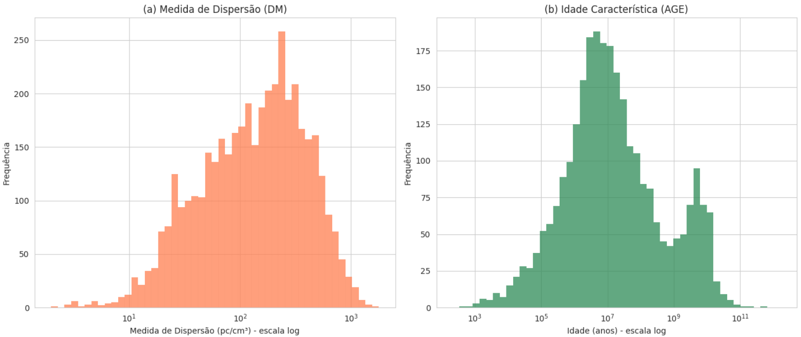
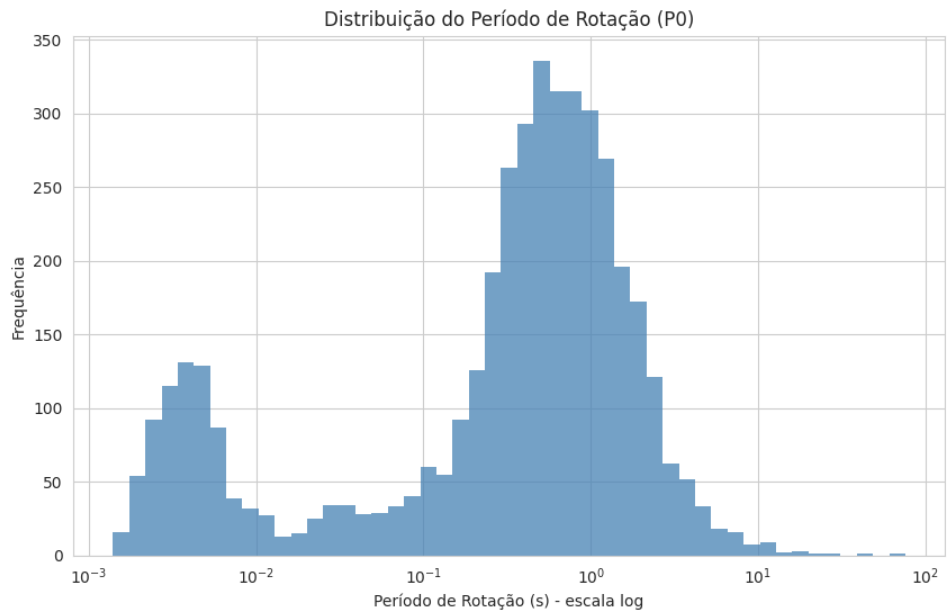
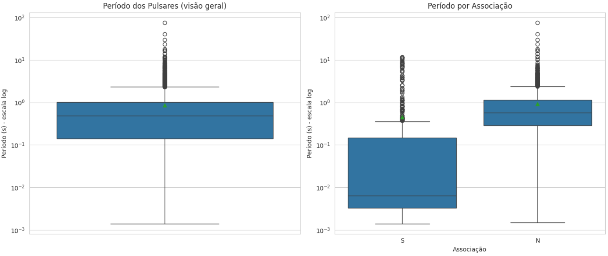
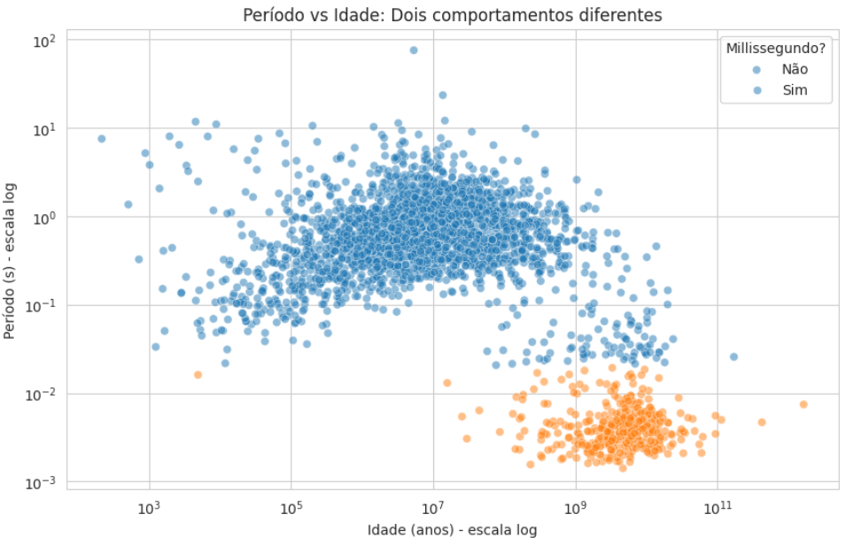

# ATNF Pulsar Catalogue - Exploratory Statistical Analysis
### Astronomical Data Analysis with Python, Pandas, and NumPy

Exploratory analysis of the **Australia Telescope National Facility (ATNF) Pulsar Catalogue**, focusing on the distribution and relationships between the catalogued properties of these objects.

The workflow uses `psrqpy` to access the catalogue, `pandas` and `numpy` to prepare and summarize the data, and `matplotlib`/`seaborn` for visualization.

The analysis uses **catalogue version 2.7.0**, updated in October 2025, containing 4,351 catalogued pulsars.

## Quick Access

- [Notebook on GitHub](https://github.com/sofiajob/ATNF-pulsar-catalogue-analysis/blob/main/notebooks/C%C3%B3pia_de_estatistica_eda_extracao_dados.ipynb)
- [Open Notebook in Google Colab](https://colab.research.google.com/github/sofiajob/ATNF-pulsar-catalogue-analysis/blob/main/notebooks/C%C3%B3pia_de_estatistica_eda_extracao_dados.ipynb)
- [Official ATNF Catalogue](https://www.atnf.csiro.au/research/pulsar/psrcat/)

## Objectives

- Explore the distributions of quantitative catalogue variables.
- Compare the mean, median, and coefficient of variation.
- Investigate differences in rotation periods across pulsar groups.
- Examine catalogued associations and relationships between period, characteristic age, and dispersion measure.
- Discuss the limitations of descriptive analysis and possible effects of observational selection.

## Data and Variables

The data are accessed through the `psrqpy` library. The analysis uses the variables listed below, including a derived variable created to simplify association information.

| Variable | Description |
|---|---|
| `TYPE` | Type or classification recorded in the catalogue, when available. |
| `TEM_ASSOC` | Derived indicator based on `ASSOC`, simplified to indicate whether a catalogued association exists. |
| `P0` | Rotation period, in seconds. |
| `DM` | Dispersion measure, representing the column density of free electrons between Earth and the pulsar, in pc/cm³. |
| `AGE` | Characteristic age, in years. |

> `TEM_ASSOC` is derived from the original `ASSOC` variable, which was simplified into a binary classification (Yes/No), indicating only whether the pulsar has any type of catalogued association record. Similarly, the characteristic age `AGE` is not necessarily a direct measurement of the object's actual age.

## Main Exploratory Findings

| Finding | Observed Evidence | Cautious Interpretation |
|---|---|---|
| High proportion without a catalogued association | 84.3% of the analyzed records have no association recorded in the derived variable. | An association is not catalogued for most of the sample. |
| High variability in characteristic age | Mean of approximately 2 billion years, median of around 10 million years, and reported CV of 1570%. | The difference between the mean and median indicates strong right skewness and the influence of high values. |
| Variability in rotation period | Mean of 0.85 s, median of 0.37 s, and CV of 220%. | The distribution is asymmetric and covers a wide range of periods. |
| Distribution of DM | The highest observed concentration falls within the 100–1000 pc/cm³ range. | The distribution may reflect both the properties of the objects and observational selection and detection limits. |
| Groups with different periods | The exploratory analysis distinguishes pulsars with periods of 0.5–5 s from millisecond objects in the approximate range of 0.001–0.01 s. | The histogram suggests groups with different periods, but visual separation alone does not constitute a formal test of distinct populations. |

## 1. Pulsar Classification and Associations

### Distribution of `TYPE`

| Category | Absolute Frequency | Relative Frequency |
|---|---:|---:|
| HE | 253 | 41.9% |
| RRAT | 220 | 36.5% |
| NRAD | 93 | 15.4% |
| AXP | 24 | 4.0% |
| XINS | 5 | 0.8% |
| Unidentified | 8 | 1.3% |
| **Total Classified** | **603** | **13.9% of the sample** |

The HE, RRAT, and NRAD categories account for **93.8%** of the records classified under this variable. AXP and XINS are types associated with recent or rare detections.

### Distribution of `TEM_ASSOC`

| Catalogued Association | Absolute Frequency | Relative Frequency |
|---|---:|---:|
| With catalogued association (`S`) | 683 | 15.7% |
| Without catalogued association (`N`) | 3,668 | 84.3% |
| **Total** | **4,351** | **100%** |

The predominance of pulsars without a known association (84.3%) reflects the challenge of tracing the origins of these old objects, whose formation evidence often dissipates over time.

## 2. Distribution and Summary Statistics

| Variable | Mean | Median | Coefficient of Variation (CV) |
|---|---:|---:|---:|
| `P0` — period | 0.85 s | 0.37 s | 220% |
| `DM` — dispersion measure | 351 pc/cm³ | 163 pc/cm³ | 98% |
| `AGE` — characteristic age | Approximately 2 billion years | Approximately 10 million years | 1570% |

For all three variables, the mean is higher than the median, which is consistent with right-skewed distributions. This difference is particularly pronounced in `AGE`, where a few very high values can strongly influence the mean. The CV of 1570% confirms the high heterogeneity of the data.

### How to Interpret a CV of 1570%?

The coefficient of variation is calculated as the ratio of the standard deviation to the mean, multiplied by 100:

**CV (%) = (standard deviation / mean) × 100**

A **CV of 1570%** means that the standard deviation is approximately **15.7 times the mean**. This indicates an extremely high degree of relative dispersion. Since the characteristic age distribution is strongly skewed, the CV should be interpreted cautiously and alongside the median, quantiles, and distribution plots.

The CV does not, by itself, demonstrate the existence of physical subpopulations. Investigating distinct groups would require additional analyses and explicit classification criteria.

## 3. Individual Distributions

### Dispersion Measure (`DM`)

- The highest concentration observed in the dataset falls within the **100–1000 pc/cm³** range.
- Frequency decreases at higher ranges.
- The distribution should be interpreted considering distance, location in the interstellar medium, detectability, and catalogue inclusion criteria. For example, pulsars with high DM values are located in high-density regions or at greater distances, which makes their detection more difficult.

**Interpretation:** The observed distribution does not depend solely on the physical properties of pulsars. Detection limitations and sample selection may influence which objects are discovered and catalogued. The histogram alone cannot quantify an observational bias or identify its cause.

### Characteristic Age (`AGE`)

- Main observed peak in the **10⁶–10⁷ years** range (1 to 10 million years).
- Right tail extending to approximately **10¹⁰ years** (very old pulsars with slow rotation).
- Lower values appear in ranges close to **10³–10⁵ years** (young pulsars with rapid rotation).

**Interpretation:** The difference between the mean and median shows that the distribution is strongly skewed. The presence of extreme values must be considered when summarizing this variable; characteristic age should not be interpreted as the actual age of each pulsar.

## 4. Rotation Period (`P0`)

| Exploratory Group | Period Range | General Characteristic |
|---|---|---|
| Pulsars with longer periods | 0.5–5 s | Relatively long periods compared with millisecond pulsars. |
| Millisecond pulsars | 0.001–0.01 s | Extremely short periods. |

The distribution shows objects with both very short and longer periods. The difference between these ranges is consistent with the descriptive distinction between millisecond pulsars and other groups.

However, histogram analysis alone is not sufficient to formally establish that there are exactly two statistical populations. The number of groups and their boundaries depend on the criteria adopted and on additional analyses.

## 5. Rotation Period by Catalogued Association

The exploratory comparison between the groups showed the following pattern:

| Group | Pattern Observed in the Exploratory Summary |
|---|---|
| With catalogued association (`S`) | Relatively shorter periods and lower dispersion. |
| Without catalogued association (`N`) | Relatively longer periods and higher dispersion. |

The data indicate that pulsars with a catalogued association tend to have shorter periods and a more homogeneous distribution compared with those without an association. However, this pattern describes the analyzed sample and does not demonstrate that having a catalogued association causes differences in rotation period. The groups may differ in other aspects, and the availability of associations may be related to observational factors and sample composition.

## 6. Relationship Between Rotation Period and Characteristic Age

| Exploratory Group | Observed Behavior |
|---|---|
| Pulsars with `P0 ≥ 0.02 s` | The analysis suggests an increase in rotation period as a function of characteristic age in part of the records, consistent with the general framework of rotational slowdown. |
| Pulsars with `P0 < 0.02 s` | Includes objects with very short periods and high characteristic ages, approximately between 10⁸ and 10¹⁰ years in part of the sample. |

Millisecond pulsars can have very short periods even at high characteristic ages. This pattern should not be described as "anomalous" simply because it differs from the behavior of other groups: its physical interpretation requires consideration of the evolutionary processes of these objects and the limitations of characteristic age.

## Glossary

| Term | Meaning |
|---|---|
| **Pulsar** | A neutron star that emits beams of radiation observed as pulses due to its rotation and the geometry of the system. |
| **Rotation Period (`P0`)** | The time required for one rotation, measured in seconds. |
| **Dispersion Measure (`DM`)** | The integrated column density of free electrons along the line of sight, expressed in pc/cm³; it affects the propagation of radio signals. |
| **Characteristic Age (`AGE`)** | An estimate derived from rotational properties, which is not necessarily equivalent to the object's actual age. |
| **Catalogued Association** | A relationship recorded in the catalogue between a pulsar and another object or structure, according to the classification used. |
| **Mean** | The sum of all values divided by the number of observations; it can be influenced by extreme values. |
| **Median** | The central value of an ordered distribution; it is less sensitive to extreme values than the mean. |
| **Coefficient of Variation (CV)** | The standard deviation divided by the mean and expressed as a percentage; it measures relative dispersion and should be interpreted cautiously in skewed distributions. |
| **Observational Bias** | A systematic difference between the detected objects and the population intended for study, caused by observational limitations or conditions. |

## Limitations

- The catalogue is an observational source: the available sample depends on detection, follow-up observations, measurements, and record updates.
- Missing or unrecorded values may affect the number of observations used in each analysis.
- The `TEM_ASSOC` variable simplifies association information and does not represent a definitive classification of physical origin.
- Mean, median, and CV summarize different aspects of a distribution. For strongly skewed variables, quantiles and plots should also be considered.
- The observed relationships are exploratory. Correlation or differences between groups do not establish causality.
- Results may vary depending on the catalogue version and the filtering criteria used to extract the data.

## Technologies and Tools

| Technology | Use |
|---|---|
| Python | Main programming language |
| `psrqpy` | Access to the ATNF catalogue |
| `pandas` | Tabular data manipulation and analysis |
| `numpy` | Numerical calculations |
| `matplotlib` and `seaborn` | Data visualization |
| Google Colab | Cloud-based development environment |

## How to Reproduce the Analysis

1. Open the [notebook in Google Colab](https://colab.research.google.com/github/sofiajob/ATNF-pulsar-catalogue-analysis/blob/main/notebooks/C%C3%B3pia_de_estatistica_eda_extracao_dados.ipynb).
2. Run the cells in the order presented.
3. If prompted, install the dependencies specified in the notebook.
4. Consult the [`psrqpy` documentation](https://psrqpy.readthedocs.io/) and the [official ATNF catalogue](https://www.atnf.csiro.au/research/pulsar/psrcat/) for information about the data.

Results may vary depending on the catalogue version accessed and the filters applied.

## References
- [ATNF Pulsar Catalogue](https://www.atnf.csiro.au/research/pulsar/psrcat) - Official database
- **Manchester, R. N.** et al. (2005) - The Australia Telescope National Facility Pulsar Catalogue. *The Astronomical Journal*, 129(4), 1993. DOI: [10.1086/428488](https://doi.org/10.1086/428488)
- **Pitkin, M.** (2018) - psrqpy: Python interface for ATNF catalogue. *JOSS*, 3(22), 538. DOI: [10.21105/joss.00538](https://doi.org/10.21105/joss.00538) | [GitHub](https://github.com/mattpitkin/psrqpy)

## Author
**Sofia Fernandes Job Junqueira**

Independent project focused on exploratory analysis, applied statistics, and scientific data visualization.
