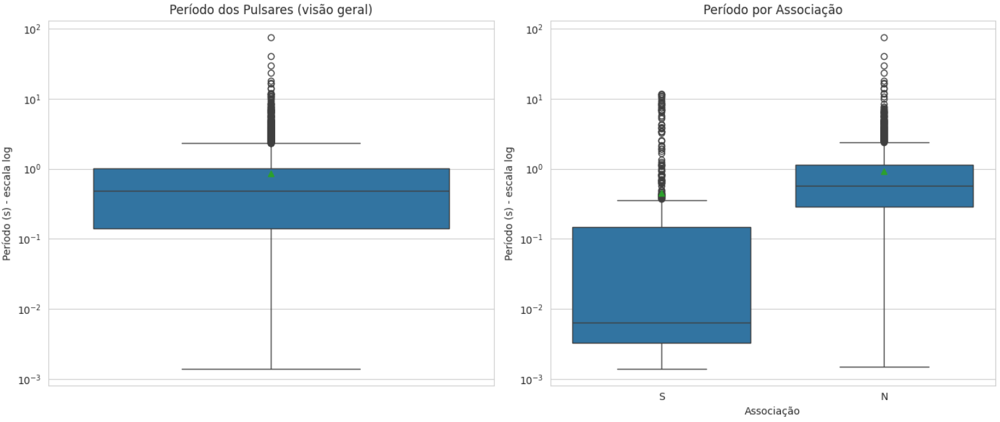

# ATNF Pulsar Catalogue - Análise Estatística Exploratória
### Análise de dados astronômicos com Python, Pandas e NumPy

Análise exploratória do catálogo de pulsares do **Australia Telescope National Facility (ATNF)**, com foco na distribuição e nas relações entre propriedades catalogadas desses objetos.

O fluxo de trabalho utiliza `psrqpy` para acessar o catálogo, `pandas` e `numpy` para preparar e resumir os dados e `matplotlib`/`seaborn` para visualização.

Foi Utilizada a **versão 2.7.0 do catálogo**, atualizada em outubro de 2025, contendo 4.351 pulsares catalogados

## Acessos rápidos

- [Notebook no GitHub](https://github.com/sofiajob/ATNF-pulsar-catalogue-analysis/blob/main/notebooks/C%C3%B3pia_de_estatistica_eda_extracao_dados.ipynb)
- [Abrir notebook no Google Colab](https://colab.research.google.com/github/sofiajob/ATNF-pulsar-catalogue-analysis/blob/main/notebooks/C%C3%B3pia_de_estatistica_eda_extracao_dados.ipynb)
- [Catálogo oficial ATNF](https://www.atnf.csiro.au/research/pulsar/psrcat/)

## Objetivos

- Explorar distribuições de variáveis quantitativas do catálogo.
- Comparar média, mediana e coeficiente de variação.
- Investigar diferenças no período de rotação entre grupos de pulsares.
- Examinar associações catalogadas e relações entre período, idade característica e medida de dispersão.
- Discutir limites da análise descritiva e possíveis efeitos da seleção observacional.

## Dados e variáveis

Os dados são acessados por meio da biblioteca `psrqpy`. A análise utiliza as variáveis abaixo, incluindo uma variável derivada para simplificar a informação de associação.

| Variável | Descrição |
|---|---|
| `TYPE` | Tipo ou classificação registrada no catálogo, quando disponível. |
| `TEM_ASSOC` | Indicador derivado de `ASSOC`, simplificado para indicar se existe uma associação catalogada. |
| `P0` | Período de rotação, em segundos. |
| `DM` | Medida de dispersão, quantidade de elétrons livres entre a Terra e o pulsar em pc/cm³. |
| `AGE` | Idade característica, em anos. |

> `TEM_ASSOC` é derivada da variável original `ASSOC`, que foi simplificada para uma classificação binária (Sim/Não), indicando apenas se o pulsar possui qualquer tipo de registro de associação catalogado. Da mesma forma, a idade característica `AGE` não é necessariamente uma medição direta da idade real do objeto.

## Principais resultados exploratórios

| Resultado | Evidência observada | Interpretação cautelosa |
|---|---|---|
| Alta proporção sem associação catalogada | 84,3% dos registros analisados não têm associação registrada na variável derivada. | A associação não está catalogada para a maioria da amostra. |
| Grande variabilidade da idade característica | Média de aproximadamente 2 bilhões de anos, mediana de cerca de 10 milhões de anos e CV reportado de 1570%. | A diferença entre média e mediana indica forte assimetria à direita e influência de valores elevados. |
| Variabilidade do período de rotação | Média de 0,85 s, mediana de 0,37 s e CV de 220%. | A distribuição é assimétrica e abrange períodos muito diferentes. |
| Distribuição de DM | Maior concentração observada na faixa de 100–1000 pc/cm³. | A forma da distribuição pode refletir tanto propriedades dos objetos quanto seleção e limites observacionais. |
| Grupos com períodos distintos | A análise exploratória distingue pulsares com períodos de 0,5–5 s e objetos de milissegundos na faixa aproximada de 0,001–0,01 s. | O histograma sugere grupos com períodos diferentes, mas a separação visual, por si só, não constitui um teste formal de populações distintas. |

## 1. Classificação e associação dos pulsares

### Distribuição de `TYPE`

| Categoria | Frequência absoluta | Frequência relativa |
|---|---:|---:|
| HE | 253 | 41,9% |
| RRAT | 220 | 36,5% |
| NRAD | 93 | 15,4% |
| AXP | 24 | 4,0% |
| XINS | 5 | 0,8% |
| Sem identificação | 8 | 1,3% |
| **Total classificado** | **603** | **13,9% da amostra** |

As categorias HE, RRAT e NRAD representam **93.8%** dos registros classificados nessa variável. AXP e XINS são tipos com detecção recente ou rara.

### Distribuição de `TEM_ASSOC`

| Associação catalogada | Frequência absoluta | Frequência relativa |
|---|---:|---:|
| Com associação catalogada (`S`) | 683 | 15,7% |
| Sem associação catalogada (`N`) | 3.668 | 84,3% |
| **Total** | **4.351** | **100%** |

A predominância de pulsares sem associação conhecida (84.3%) reflete o desafio de rastrear a origem desses objetos antigos, cujas evidências de formação frequentemente se dissipam.

## 2. Distribuição e medidas de resumo

| Variável | Média | Mediana | Coeficiente de variação (CV) |
|---|---:|---:|---:|
| `P0` — período | 0,85 s | 0,37 s | 220% |
| `DM` — medida de dispersão | 351 pc/cm³ | 163 pc/cm³ | 98% |
| `AGE` — idade característica | Aproximadamente 2 bilhões de anos | Aproximadamente 10 milhões de anos | 1570% |

Nas três variáveis, a média é superior à mediana, o que é compatível com assimetria à direita. A diferença é particularmente expressiva em `AGE`, na qual poucos valores muito elevados podem influenciar fortemente a média. O CV de 1570% confirma a alta heterogeneidade dos dados.

### Como interpretar o CV de 1570%?

O coeficiente de variação é calculado pela razão entre o desvio-padrão e a média, multiplicada por 100:

**CV (%) = (desvio-padrão / média) × 100**

Um CV de **1570%** significa que o desvio-padrão corresponde a aproximadamente **15,7 vezes a média**. É uma medida de dispersão relativa extremamente elevada. Como a distribuição da idade característica é fortemente assimétrica, o CV deve ser interpretado com cautela e em conjunto com a mediana, os quantis e a visualização da distribuição.

O CV não comprova, por si só, a existência de subpopulações físicas. Para investigar grupos distintos, seriam necessárias análises adicionais e critérios explícitos de classificação.

## 3. Distribuições individuais

### Medida de dispersão (`DM`)

- A maior concentração observada no recorte está entre **100 e 1000 pc/cm³**.
- A frequência diminui em faixas mais altas.
- A distribuição deve ser interpretada considerando distância, localização no meio interestelar, detectabilidade e critérios de inclusão no catálogo. Exemplo: Pulsares com DM alto estão em regiões de alta densidade ou grandes distâncias, o que dificulta sua detecção

**Interpretação:** a distribuição observada não depende apenas das propriedades físicas dos pulsares. Limitações de detecção e seleção da amostra podem influenciar quais objetos são encontrados e catalogados. O histograma, isoladamente, não permite quantificar um viés observacional nem identificar sua causa.

### Idade característica (`AGE`)

- Pico principal observado na faixa de **10⁶–10⁷ anos** (1 a 10 milhões de anos).
- Cauda à direita que se estende até aproximadamente **10¹⁰ anos** (pulsares muito velhos, rotação lenta).
- Valores mais baixos aparecem em faixas próximas de **10³–10⁵ anos** (pulsares jovens, rotação rápida).

**Interpretação:** a diferença entre média e mediana mostra que a distribuição é fortemente assimétrica. A presença de valores extremos deve ser considerada ao resumir a variável; a idade característica também não deve ser confundida automaticamente com a idade real de cada pulsar.

## 4. Período de rotação (`P0`)

| Grupo exploratório | Faixa de período | Característica geral |
|---|---|---|
| Pulsares com períodos mais longos | 0,5–5 s | Períodos relativamente longos em comparação com os pulsares de milissegundos. |
| Pulsares de milissegundos | 0,001–0,01 s | Períodos extremamente curtos. |

A distribuição mostra objetos com períodos muito curtos e outros com períodos mais longos. A diferença entre essas faixas é consistente com a distinção descritiva entre pulsares de milissegundos e outros grupos.

A análise de um histograma, entretanto, não basta para afirmar formalmente que há exatamente duas populações estatísticas. A quantidade de grupos e seus limites dependem dos critérios adotados e de análises adicionais.

## 5. Período por associação catalogada

A comparação exploratória entre os grupos apresentou o seguinte padrão:

| Grupo | Padrão observado no resumo exploratório |
|---|---|
| Com associação catalogada (`S`) | Períodos relativamente menores e menor dispersão. |
| Sem associação catalogada (`N`) | Períodos relativamente maiores e maior dispersão. |

Os dados indicam que pulsares com associação catalogada tendem a períodos mais curtos e distribuição mais homogênea em comparação aos sem associação. Entretanto, esse padrão descreve a amostra analisada e não demonstra que possuir uma associação catalogada cause diferenças no período. Os grupos podem diferir em outros aspectos, e a disponibilidade de associações pode estar relacionada a fatores observacionais e à composição da amostra.

## 6. Relação entre período e idade característica

| Grupo exploratório | Comportamento observado |
|---|---|
| Pulsares com `P0 ≥ 0,02 s` | A análise sugere aumento do período em função da idade característica em parte dos registros, compatível com o quadro geral de desaceleração rotacional. |
| Pulsares com `P0 < 0,02 s` | Inclui objetos de período muito curto e idade característica elevada, aproximadamente entre 10⁸ e 10¹⁰ anos em parte da amostra. |

Os pulsares de milissegundos podem apresentar períodos muito curtos mesmo com idades características elevadas. Esse padrão não deve ser chamado de “anômalo” apenas por diferir do comportamento de outros grupos: a interpretação física exige considerar os processos de evolução desses objetos e as limitações da idade característica.

## Glossário

| Termo | Significado |
|---|---|
| **Pulsar** | Estrela de nêutrons que emite feixes de radiação observados como pulsos devido à rotação e à geometria do sistema. |
| **Período de rotação (`P0`)** | Tempo necessário para uma rotação, medido em segundos. |
| **Medida de dispersão (`DM`)** | Quantidade integrada de elétrons livres ao longo da linha de visada, expressa em pc/cm³; afeta a propagação dos sinais de rádio. |
| **Idade característica (`AGE`)** | Estimativa derivada de propriedades de rotação, que não equivale necessariamente à idade real do objeto. |
| **Associação catalogada** | Relação registrada no catálogo entre um pulsar e outro objeto ou estrutura, conforme a classificação consultada. |
| **Média** | Soma dos valores dividida pelo número de observações; pode ser influenciada por valores extremos. |
| **Mediana** | Valor central da distribuição ordenada; é menos sensível a valores extremos do que a média. |
| **Coeficiente de variação (CV)** | Desvio-padrão dividido pela média e expresso em porcentagem; mede dispersão relativa e requer cautela em distribuições assimétricas. |
| **Viés observacional** | Diferença sistemática entre os objetos detectados e a população que se pretende estudar, causada por limites ou condições de observação. |

## Limitações

- O catálogo é uma fonte observacional: a amostra disponível depende de detecção, acompanhamento, medição e atualização dos registros.
- Valores ausentes ou não registrados podem afetar a quantidade de observações utilizada em cada análise.
- A variável `TEM_ASSOC` simplifica a informação de associação e não representa uma classificação definitiva da origem física.
- Média, mediana e CV resumem aspectos diferentes da distribuição. Em variáveis fortemente assimétricas, é importante considerar quantis e gráficos.
- As relações observadas são exploratórias. Correlação ou diferença entre grupos não estabelece causalidade.
- Resultados podem variar conforme a versão do catálogo e os critérios de filtragem usados para extrair os dados.

## Tecnologias e ferramentas

| Tecnologia | Uso |
|---|---|
| Python | Linguagem principal |
| `psrqpy` | Acesso ao catálogo ATNF |
| `pandas` | Manipulação e análise tabular |
| `numpy` | Cálculos numéricos |
| `matplotlib` e `seaborn` | Visualização de dados |
| Google Colab | Ambiente de desenvolvimento em nuvem |

## Como reproduzir

1. Abra o [notebook no Google Colab](https://colab.research.google.com/github/sofiajob/ATNF-pulsar-catalogue-analysis/blob/main/notebooks/C%C3%B3pia_de_estatistica_eda_extracao_dados.ipynb).
2. Execute as células na ordem apresentada.
3. Caso seja solicitado, instale as dependências indicadas no notebook.
4. Consulte a documentação do [`psrqpy`](https://psrqpy.readthedocs.io/) e o [catálogo oficial ATNF](https://www.atnf.csiro.au/research/pulsar/psrcat/) para informações sobre os dados.

Os resultados podem variar de acordo com a versão do catálogo consultada e os filtros aplicados.

## Referências
- [ATNF Pulsar Catalogue](https://www.atnf.csiro.au/research/pulsar/psrcat) - Base de dados oficial
- **Manchester, R. N.** et al. (2005) - The Australia Telescope National Facility Pulsar Catalogue. *The Astronomical Journal*, 129(4), 1993. DOI: [10.1086/428488](https://doi.org/10.1086/428488)
- **Pitkin, M.** (2018) - psrqpy: Python interface for ATNF catalogue. *JOSS*, 3(22), 538. DOI: [10.21105/joss.00538](https://doi.org/10.21105/joss.00538) | [GitHub](https://github.com/mattpitkin/psrqpy)

## Autoria

**Sofia Fernandes Job Junqueira**

Projeto independente de análise exploratória, estatística aplicada e visualização de dados científicos.
