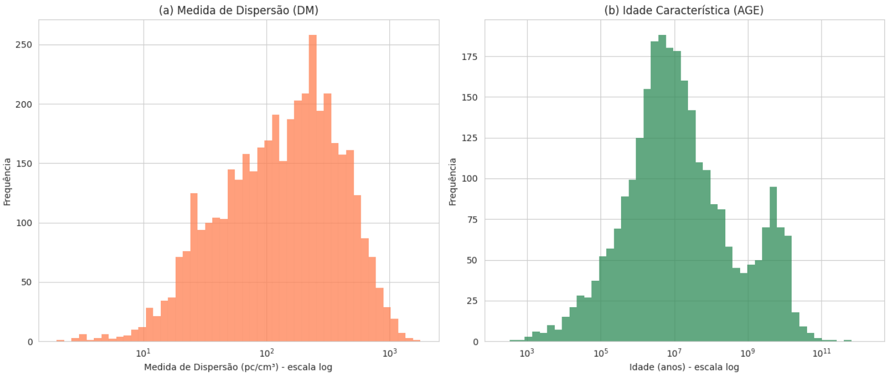
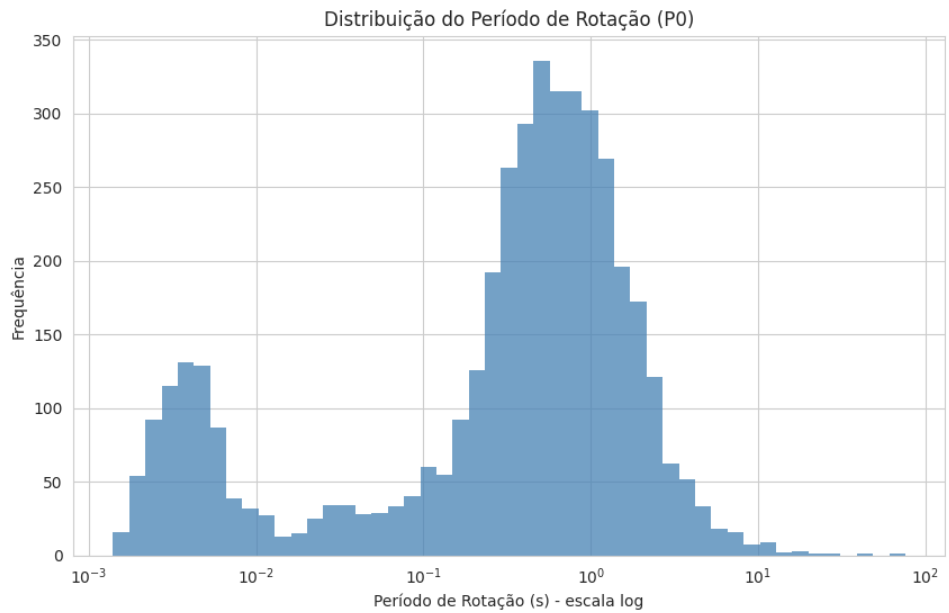
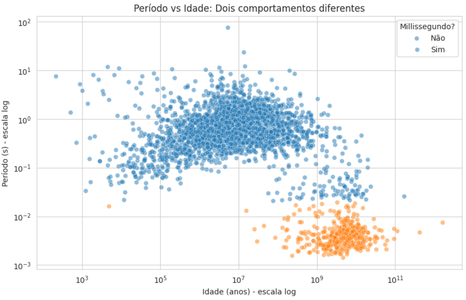

# 📈 ATNF Pulsar Catalogue - Análise Estatística Exploratória

## Sobre o Projeto

### Análise estatística exploratória do catálogo de pulsares do Australia Telescope National Facility, investigando distribuições e relações entre propriedades físicas desses objetos para a disciplina de Estatística Aplicada I

## Principais Descobertas

| Descoberta | Explicação |
|:-----------|:--------|
| **Millissegundos: velhos mas rápidos** | Período de 0,001-0,01s com bilhões de anos de idade |
| **Pulsares Normais: desaceleram** | tendem a desacelerar com o aumento da idade |
| **84,3% sem associação catalogada** | Apenas 15,7% dos pulsares têm origem conhecida (grande potencial para novas descobertas) |
| **CV da idade: 1570%** | Média de ~2 bilhões de anos vs mediana de ~10 milhões (poucos pulsares extremamente velhos puxam a média) |
| **CV do período: 220%** | Período é 2x mais disperso que a medida de dispersão (maior diversidade comportamental) |
| **Duas populações distintas** | Pulsares normais (0,5-5s) vs millissegundos (0,001-0,01s). Evidência clara no histograma |
| **Viés observacional no DM** | Pulsares com alta medida de dispersão estão em regiões de difícil detecção |

### 🔗 [Open in Colab - ATNF Pulsar Catalogue Análise e Vizualizações](notebooks/Cópia_de_estatistica_eda_extracao_dados.ipynb)

---

## Variáveis Selecionadas
  
| Variável | Descrição |
|------|-----------|
| `TYPE` | Classificação quanto ao tipo de pulsar (normal, millisecond, AXP, etc.) |
| `TEM_ASSOC` | Associação a remanescentes de supernova ou aglomerados catalogada |
| `P0` | Período de rotação (segundos) |
| `DM` | Medida de dispersão (quantidade de elétrons livres entre a Terra e o pulsar em pc/cm³) |
| `AGE` | Idade característica (anos) |

> Nota: `TEM_ASSOC` é derivada da váriavel original `ASSOC`, que foi simplificada para uma classificação binária (Sim/Não), indicando apenas se o pulsar possui qualquer tipo de registro de associação catalogado.

---

## Discussão das Principais Descobertas da Análise

### 1. Classificação e Associação dos Pulsares

<strong>Tabela 1: Distribuição da variável TYPE</strong>

| Categoria | Freq. Absoluta | Freq. Relativa (%) |
|:---------:|:--------------:|:------------------:|
| HE | 253 | 41.9% |
| RRAT | 220 | 36.5% |
| NRAD | 93 | 15.4% |
| AXP | 24 | 4.0% |
| XINS | 5 | 0.8% |
| Sem identificação | 8 | 1.3% |
| **Total de classificados** | **603** | **13.9% da amostra** |

 

<strong>Tabela 2: Distribuição da variável TEM_ASSOC</strong>

| Associação | Freq. Absoluta | Freq. Relativa (%) |
|:----------:|:--------------:|:------------------:|
| Com associação catalogada (S) | 683 | 15.7% |
| Sem associação conhecida (N) | 3.668 | 84.3% |
| **Total** | **4.351** | **100%** |

### 💡 **Insight:** As categorias HE, RRAT e NRAD representam **93.8%** dos pulsares classificados. AXP e XINS são tipos raros ou de detecção recente.

### 💡 **Insight:** A predominância de pulsares sem associação conhecida (84.3%) reflete o desafio de rastrear a origem desses objetos antigos, cujas evidências de formação frequentemente se dissipam.

---

### 2. Distribuição e Medidas de Resumo

| Variável | Média | Mediana | CV |
|:--------:|:-----:|:-------:|:---:|
| **P0** (período) | 0,85s | 0,37s | 220% |
| **DM** (dispersão) | 351 pc/cm³ | 163 pc/cm³ | 98% |
| **AGE** (idade) | ~2 bi anos | ~10 mi anos | 1570% |

### 💡 **Insight:** As variáveis apresentam distribuições assimétricas positivas (média > mediana), indicando maior diversidade comportamental entre os pulsares catalogados.

### 💡 **Insight:** em `AGE`, a enorme diferença entre média e mediana revela uma **forte assimetria à direita** (poucos pulsares extremamente velhos puxam a média para cima). O CV de 1570% confirma a alta heterogeneidade dos dados.

---

### 4. Distribuições Individuais

#### Medida de Dispersão (DM)
- **Maior concentração:** 100 – 1000 pc/cm³
- **Frequência decrescente** para valores mais altos
- **Viés observacional:** Pulsares com DM alto estão em regiões de alta densidade ou grandes distâncias, o que dificulta sua detecção

#### Idade Característica (AGE)
- **Pico principal:** 10⁶ – 10⁷ anos (1 a 10 milhões de anos)
- **Cauda à direita:** Estende-se até 10¹⁰ anos (pulsares muito velhos, rotação lenta)
- **Cauda à esquerda:** 10³ – 10⁵ anos (pulsares jovens, rotação rápida)

### 💡 **Insight:** A distribuição de DM é reflexo de um **viés observacional** presente no catálogo.
### 💡 **Insight:** A distribuição assimétrica da idade reforça a **existência de subpopulações** no catálogo.

---

### 5. Período de Rotação (P0) — Descoberta Principal

| População | Faixa de Período | Característica |
|:---------:|:----------------:|:--------------:|
| **Pulsares normais** | 0,5 – 5 segundos | Maioria da amostra, rotação lenta |
| **Millissegundos** | 0,001 – 0,01 segundos | Minoria, rotação extremamente rápida |

### 💡 **Insight:** Embora menos numerosos, os pulsares millissegundos evidenciam a existência de **duas populações com comportamentos rotacionais distintos**. A frequência decai progressivamente para períodos >5s, indicando que pulsares muito lentos são raros no catálogo.

---

### 6. Relação Período × Idade

| População | Comportamento Observado |
|:---------:|:-----------------------:|
| **Pulsares normais** (P0 ≥ 0,02s) | Período **aumenta com a idade** — consistente com a perda gradual de energia rotacional |
| **Millissegundos** (P0 < 0,02s) | **Extremamente velhos (10⁸–10¹⁰ anos), mas muito rápidos (0,001–0,02s)** — comportamento anômalo |

### 💡 **Insight:** A separação clara entre as duas populações confirma que **millissegundos evoluem de maneira completamente diferente** dos pulsares normais, consistente com a teoria de reaceleração por transferência de momento angular em sistemas binários (Lorimer, 2005).

---

## Tecnologias e Ferramentas Utilizadas

| Tecnologia | Finalidade |
|------------|-------------|
| Python | Linguagem principal |
| psrqpy | Interface para ATNF Pulsar Catalogue |
| pandas | Manipulação de dados |
| numpy | Computação numérica |
| matplotlib/seaborn | Visualizações |
| Google Colab | Ambiente de desenvolvimento em nuvem |

---

## Autoria 
Sofia Fernandes Job Junqueira

## Referências
- [ATNF Pulsar Catalogue](https://www.atnf.csiro.au/research/pulsar/psrcat) - Base de dados oficial

- **Manchester, R. N.** et al. (2005) - The Australia Telescope National Facility Pulsar Catalogue. *The Astronomical Journal*, 129(4), 1993. DOI: [10.1086/428488](https://doi.org/10.1086/428488)
  
- **Pitkin, M.** (2018) - psrqpy: Python interface for ATNF catalogue. *JOSS*, 3(22), 538. DOI: [10.21105/joss.00538](https://doi.org/10.21105/joss.00538) | [GitHub](https://github.com/mattpitkin/psrqpy)
